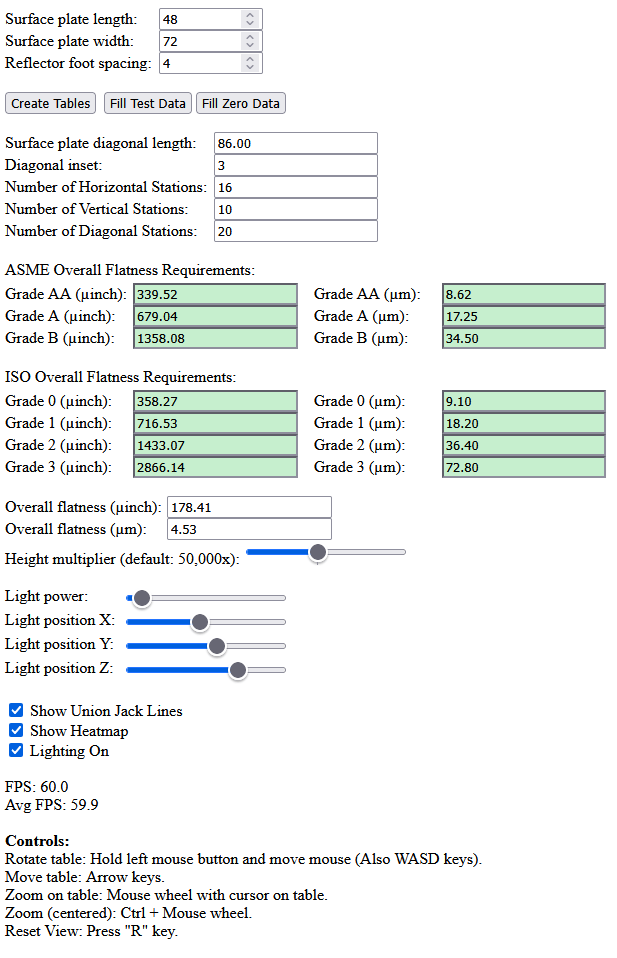
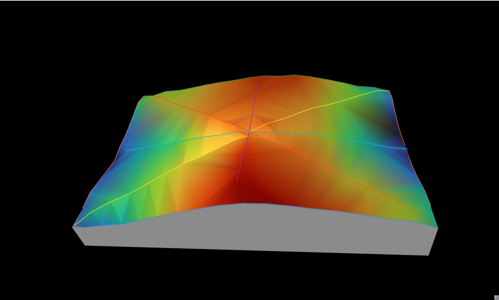
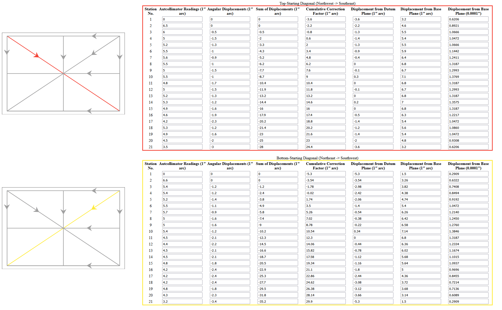

# MoodyJS

An implementation of the Moody method for calculating surface plate flatness from
autocollimator readings. MoodyJS runs in your browser and displays the calculation
tables, a 3D surface, and an isometric contour graph.

[Try it](https://brcolow.github.io/moodyjs/).

## Getting Started

To try Moody's sample data, leave the plate dimensions at **48 × 72 in** and the
reflector foot spacing at **4 in**, then click **Fill Test Data**. The tables are
created automatically.

For your own measurements:

1. Enter the plate dimensions and reflector foot spacing in **inches**.
2. Click **Create Tables**.
3. Enter the autocollimator readings in **arcseconds**, following the direction
   shown for each measurement line. The first row is a zero reference set by the app.

Use the tabs or click a line in the Union Jack diagram to select its table.
Once all readings are entered, use **View** to switch between the 3D surface and
the isometric contour graph. Height exaggeration changes the display only; it does
not change the calculated flatness.

<details>
<summary>Screenshots</summary>





</details>

## Library

* J. C. Moody, ["How to Calibrate Surface Plates in the Plant"](./Moody1995.pdf),
  *The Tool Engineer*, October 1955 (reprint).
* Bruce Allen's [corrections to Moody's article](./MoodyCorrections.pdf), with
  additional references. See also [ballen4705/Moody-Method](https://github.com/ballen4705/Moody-Method).
* [Standards references](./references/README.md), including a local ASME case PDF
  and ISO citation details and notes.

## Overall Flatness Grades

ASME B89.3.7 defines grades **AA, A, and B**; ISO 8512-2 defines grades **0, 1, 2,
and 3**. Each standard gives overall flatness tolerances for preferred plate sizes
and a calculation for other sizes. The ASME calculation is quadratic in the plate's
diagonal length; the ISO calculation is linear. The grades are not interchangeable.

This section covers overall flatness. The standards also have separate requirements
for local flatness or repeat readings.

> **Current app behavior:** MoodyJS uses the unrounded ASME inch formula for every
> plate size and converts that result to micrometers. It does not yet select the
> applicable Table 1 tolerance or apply ASME's required rounding. The ISO calculation
> also omits the final tolerance rounding described below. These differences affect
> the displayed grade limits and their pass/fail indicators.

Throughout this section, **µin** means microinches and **µm** means micrometers:
1 µin = 0.0254 µm.

### ASME B89.3.7-2013

#### Which tolerances apply?

Section 4.3.4, *Flatness Tolerance (Entire Work Surface)*, requires all points of the
work surface to lie between two parallel planes separated by no more than the
applicable tolerance.

Table 1 specifies tolerances for standard plate sizes. For sizes outside the ±5%
allowance around the listed sizes, Section 4.3.4 provides a polynomial calculation.

**The polynomial and its rounding rule do not reproduce every value in Table 1.**
ASME addresses this in [Case B89-002, *Issues Regarding Granite Surface Plates*,
page 1, Inquiry 3 and Response 3][asme-b89-002]. The table values have historical
origins, primarily in Federal Specification GGG-P-463, and **take precedence over
calculated values**. The calculation applies when the table does not provide the
applicable tolerance.

The clarification settles which values to use; it does not change the polynomial
or rounding rule to make the two agree.

#### Calculation for non-tabulated sizes

For a rectangular plate with length $L$ and width $W$, the diagonal is:

```math
D = \sqrt{L^2 + W^2}
```

The unrounded grade AA tolerance is given by the following equations. Use
$D_{\mathrm{m}}$ for the diagonal in meters or $D_{\mathrm{in}}$ for the diagonal
in inches; the tolerance units are shown on the right.

```math
\begin{aligned}
T_{\mathrm{AA,calc}} &= 1.6D_{\mathrm{m}}^2 + 1
    && (\mu\mathrm{m}) \\
T_{\mathrm{AA,calc}} &= \frac{D_{\mathrm{in}}^2}{25} + 40
    && (\mu\mathrm{in})
\end{aligned}
```

Round the calculated grade AA tolerance **upward to a multiple of 0.5 µm or
25 µin**, depending on the unit system. Using that rounded tolerance:

```math
T_{\mathrm{A}} = 2T_{\mathrm{AA}}, \qquad
T_{\mathrm{B}} = 4T_{\mathrm{AA}}
```

#### Why the table and calculation differ

These examples substitute standard sizes into the polynomial to illustrate the
discrepancy. **Their applicable tolerances still come from Table 1.**

**12 × 12 in plate**

```math
T_{\mathrm{AA,calc}} = \frac{12^2 + 12^2}{25} + 40 = 51.52\,\mu\mathrm{in}
```

Rounding upward to a multiple of 25 µin gives **75 µin**, but Table 1 specifies
**50 µin**. The unrounded calculation is 1.52 µin higher than the table value;
rounding increases the difference to 25 µin.

**18 × 24 in plate**

```math
T_{\mathrm{AA,calc}} = \frac{18^2 + 24^2}{25} + 40 = 76\,\mu\mathrm{in}
```

Rounding upward to a multiple of 25 µin gives **100 µin**, but Table 1 specifies
**80 µin**. The unrounded calculation is 4 µin lower than the table value; rounding
puts it 20 µin higher. Also, 80 µin is not a multiple of 25 µin, so that rounding
rule cannot reproduce it.

#### Comparison of tabulated and calculated values

**All "calc." columns below are unrounded formula results.** They illustrate the
discrepancy and do not replace the applicable Table 1 tolerances.

**Difference = calculated AA tolerance − Table 1 AA tolerance.** Diagonals are
shown to two decimal places; calculations use the full diagonal.

| Plate (in) | Diagonal (in) | AA calc. (µin) | AA Table 1 (µin) | Difference (µin) |
|:---|---:|---:|---:|---:|
| 12 × 12 | 16.97 | 51.52 | 50 | +1.52 |
| 12 × 18 | 21.63 | 58.72 | 50 | +8.72 |
| 18 × 18 | 25.46 | 65.92 | 50 | +15.92 |
| 18 × 24 | 30.00 | 76.00 | 80 | -4.00 |
| 24 × 24 | 33.94 | 86.08 | 80 | +6.08 |
| 24 × 36 | 43.27 | 114.88 | 100 | +14.88 |
| 24 × 48 | 53.67 | 155.20 | 150 | +5.20 |
| 30 × 48 | 56.60 | 168.16 | 180 | -11.84 |
| 36 × 36 | 50.91 | 143.68 | 150 | -6.32 |
| 36 × 48 | 60.00 | 184.00 | 200 | -16.00 |
| 36 × 60 | 69.97 | 235.84 | 250 | -14.16 |
| 36 × 72 | 80.50 | 299.20 | 300 | -0.80 |
| 48 × 48 | 67.88 | 224.32 | 200 | +24.32 |
| 48 × 60 | 76.84 | 276.16 | 300 | -23.84 |
| 48 × 72 | 86.53 | 339.52 | 350 | -10.48 |
| 48 × 96 | 107.33 | 500.80 | 500 | +0.80 |
| 48 × 120 | 129.24 | 708.16 | 700 | +8.16 |
| 60 × 120 | 134.16 | 760.00 | 750 | +10.00 |
| 72 × 96 | 120.00 | 616.00 | 600 | +16.00 |
| 72 × 144 | 161.00 | 1076.80 | 1100 | -23.20 |

<details>
<summary>Grade A and B comparisons</summary>

The calculated A and B values below are two and four times the **unrounded** AA
result. The Table 1 columns are the applicable tolerances for these sizes.

| Plate (in) | A calc. (µin) | A Table 1 (µin) | B calc. (µin) | B Table 1 (µin) |
|:---|---:|---:|---:|---:|
| 12 × 12 | 103.04 | 100 | 206.08 | 200 |
| 12 × 18 | 117.44 | 100 | 234.88 | 200 |
| 18 × 18 | 131.84 | 100 | 263.68 | 200 |
| 18 × 24 | 152.00 | 160 | 304.00 | 320 |
| 24 × 24 | 172.16 | 160 | 344.32 | 320 |
| 24 × 36 | 229.76 | 200 | 459.52 | 400 |
| 24 × 48 | 310.40 | 300 | 620.80 | 600 |
| 30 × 48 | 336.32 | 360 | 672.64 | 720 |
| 36 × 36 | 287.36 | 300 | 574.72 | 600 |
| 36 × 48 | 368.00 | 400 | 736.00 | 800 |
| 36 × 60 | 471.68 | 500 | 943.36 | 1000 |
| 36 × 72 | 598.40 | 600 | 1196.80 | 1200 |
| 48 × 48 | 448.64 | 400 | 897.28 | 800 |
| 48 × 60 | 552.32 | 600 | 1104.64 | 1200 |
| 48 × 72 | 679.04 | 700 | 1358.08 | 1400 |
| 48 × 96 | 1001.60 | 1000 | 2003.20 | 2000 |
| 48 × 120 | 1416.32 | 1400 | 2832.64 | 2800 |
| 60 × 120 | 1520.00 | 1500 | 3040.00 | 3000 |
| 72 × 96 | 1232.00 | 1200 | 2464.00 | 2400 |
| 72 × 144 | 2153.60 | 2200 | 4307.20 | 4400 |

</details>

### ISO 8512-2:1990

[ISO 8512-2][iso-8512-2] covers granite surface plates in grades 0, 1, 2, and 3.
MoodyJS currently calculates the limits by first rounding the diagonal in
millimeters upward to a multiple of 100 mm:

```math
d = 100\left\lceil\frac{D_{\mathrm{mm}}}{100}\right\rceil
```

The ceiling brackets round upward to an integer, leaving whole numbers unchanged.
Using $d$ in millimeters, the following equations give tolerances in micrometers:

```math
\begin{aligned}
T_0 &= 0.003d + 2.5 \\
T_1 &= 0.006d + 5 \\
T_2 &= 0.012d + 10 \\
T_3 &= 0.024d + 20
\end{aligned}
```

[Table 1, note 2][iso-preview] expresses the overall tolerances to the nearest
**0.5 µm for grade 0** and **1 µm for grades 1, 2, and 3**. MoodyJS currently
shows the formula results to two decimal places without that final rounding.

<details>
<summary>ISO grade 0 calculations for the same plate sizes</summary>

These values include the diagonal rounding above, but not the final tolerance
rounding. Converted values and diagonals are rounded for display. The comparison
does not imply that ISO grade 0 and ASME grade AA are equivalent.

| Plate (in) | Diagonal (mm) | Grade 0 calc. (µm) | Grade 0 calc. (µin) |
|:---|---:|---:|---:|
| 12 × 12 | 431.05 | 4.0 | 157.48 |
| 12 × 18 | 549.49 | 4.3 | 169.29 |
| 18 × 18 | 646.58 | 4.6 | 181.10 |
| 18 × 24 | 762.00 | 4.9 | 192.91 |
| 24 × 24 | 862.10 | 5.2 | 204.72 |
| 24 × 36 | 1098.97 | 5.8 | 228.35 |
| 24 × 48 | 1363.11 | 6.7 | 263.78 |
| 30 × 48 | 1437.74 | 7.0 | 275.59 |
| 36 × 36 | 1293.16 | 6.4 | 251.97 |
| 36 × 48 | 1524.00 | 7.3 | 287.40 |
| 36 × 60 | 1777.27 | 7.9 | 311.02 |
| 36 × 72 | 2044.66 | 8.8 | 346.46 |
| 48 × 48 | 1724.21 | 7.9 | 311.02 |
| 48 × 60 | 1951.67 | 8.5 | 334.65 |
| 48 × 72 | 2197.94 | 9.1 | 358.27 |
| 48 × 96 | 2726.21 | 10.9 | 429.13 |
| 48 × 120 | 3282.80 | 12.4 | 488.19 |
| 60 × 120 | 3407.77 | 13.0 | 511.81 |
| 72 × 96 | 3048.00 | 11.8 | 464.57 |
| 72 × 144 | 4089.32 | 14.8 | 582.68 |

</details>

## TODO

* Apply the applicable tabulated tolerances and rounding rules to the grade limits
  and pass/fail indicators.
* Show a semi-transparent plane for the selected grade AA, A, or B overall flatness
  tolerance, using the applicable tabulated or calculated limit.
* Import measurement readings from a CSV file or a textarea with a simple format.
* Add metric input for plate dimensions and reflector foot spacing.
* Show the carriage/sled locations as tick marks on the measurement lines.
* Improve color-blind accessibility.
* Add a help section explaining how to obtain the readings and enter them for
  people unfamiliar with the Moody method.
* Add an in-depth explanation of the Moody method, with references to Moody's
  paper and the discussion beginning on page 209 of K. J. Hume's *Engineering
  Metrology* (3rd edition, metric).

## Developer Notes

Serve the project over HTTP or HTTPS so that JavaScript modules and textures load
correctly. With Node.js and npm installed, run these commands from the project root:

```sh
npm install
npm run serve
```

The server opens the app at [http://localhost:5000](http://localhost:5000).
The serve script uses `npx http-server`, which may prompt to install `http-server`
if it is not already available.

To run the tests once and check lint:

```sh
npm test -- --run
npm run lint
```

## Thanks To

[Bruce Allen](https://github.com/ballen4705), whose paper corrects mistakes in
Moody's original magazine article and provides useful references.

[asme-b89-002]: ./references/ASME-B89-002.pdf#page=1 "ASME Case B89-002, page 1, Inquiry 3 and Response 3"
[iso-8512-2]: ./references/README.md#iso-8512-2 "ISO 8512-2:1990, local citation details and notes"
[iso-preview]: ./references/README.md#table-1-rounding "ISO 8512-2:1990, Table 1, note 2 (local reference notes)"
